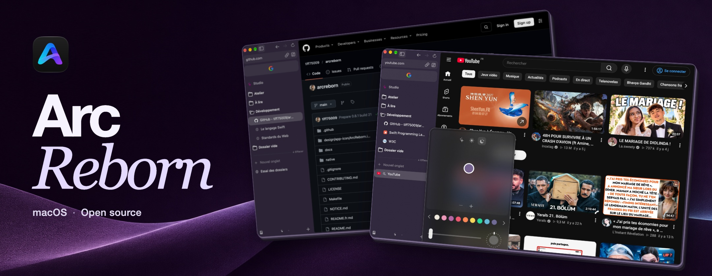
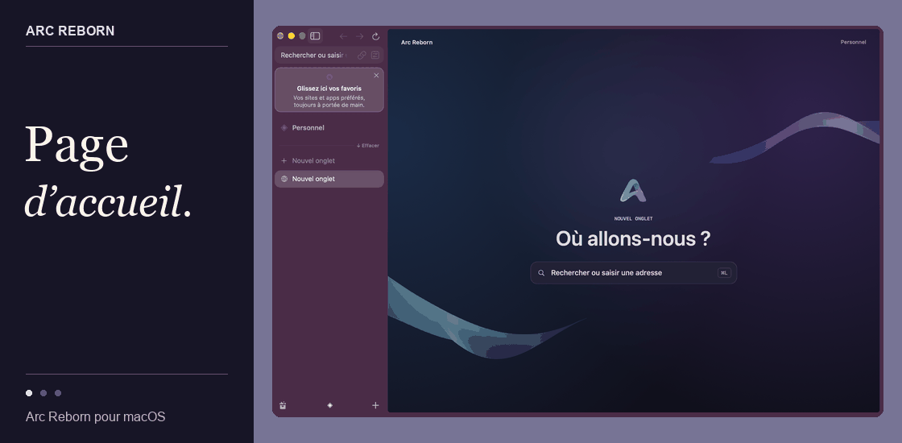
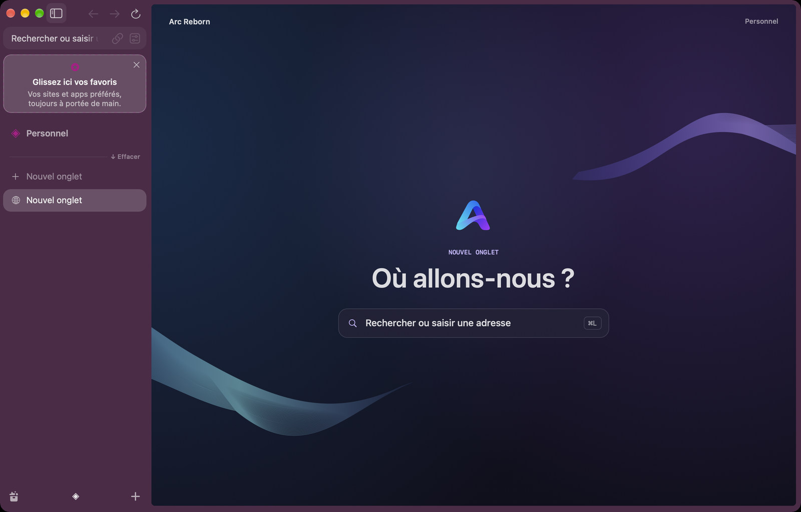
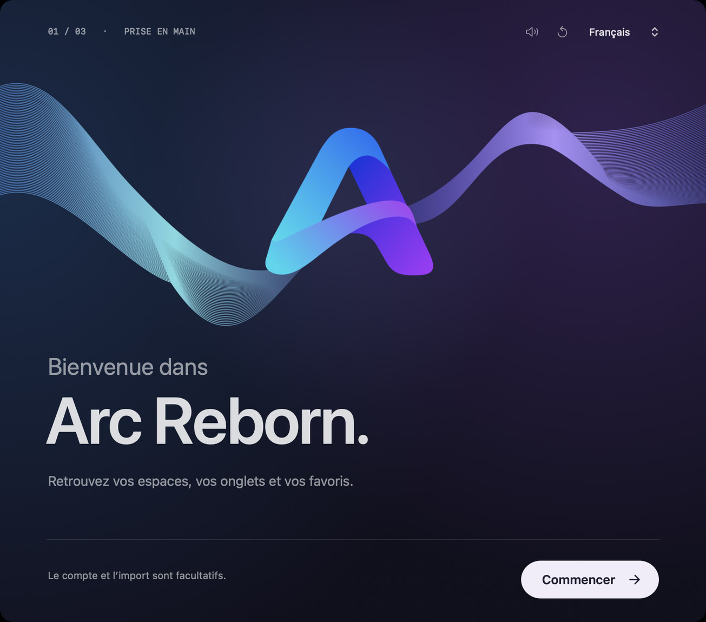
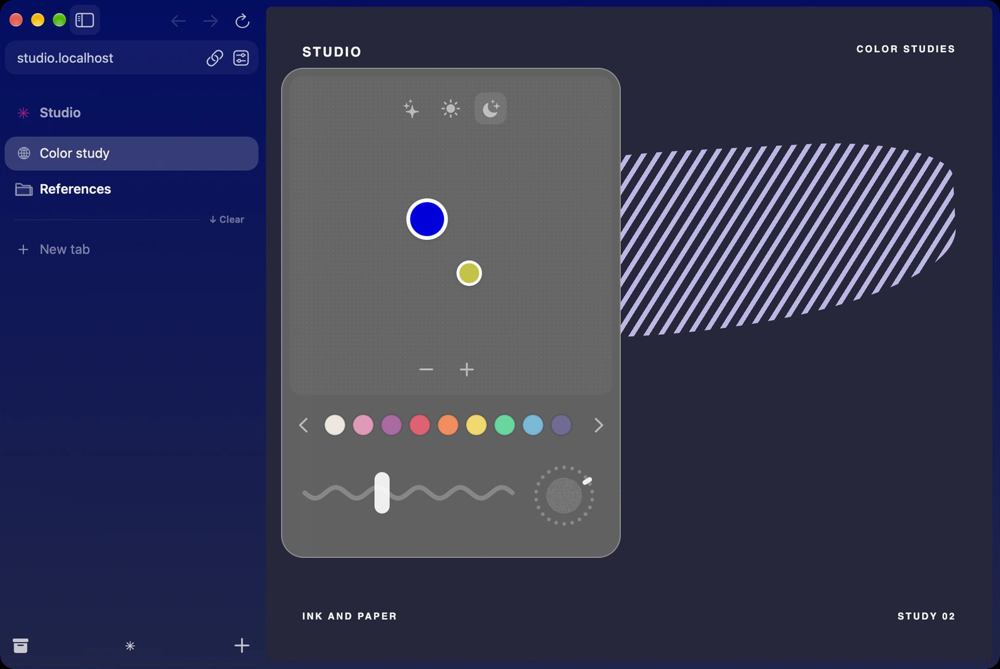
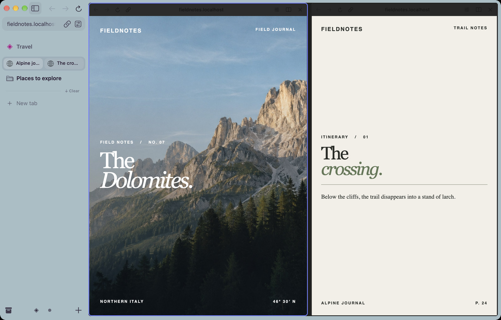
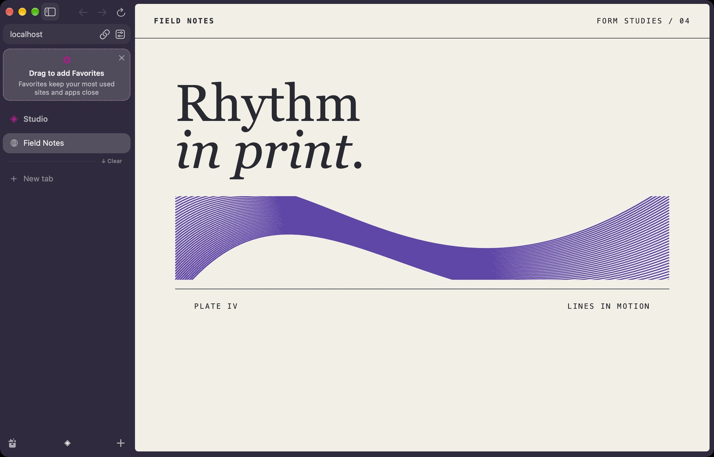
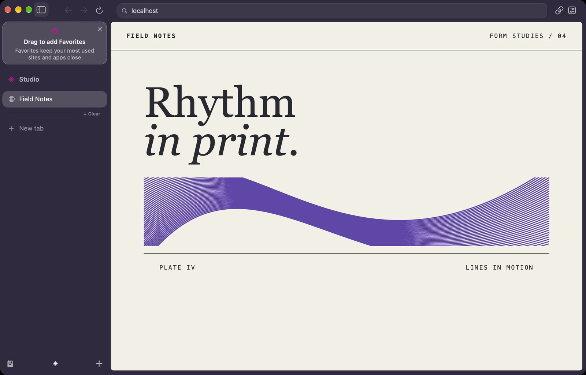
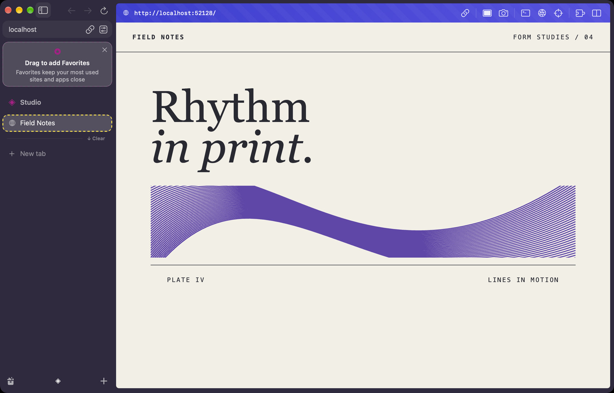
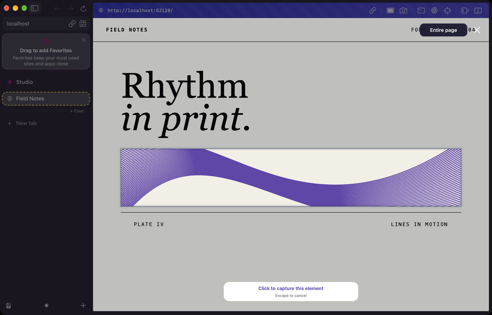

<p align="center">
  <a href="https://www.arc-reborn.com/download/mac"></a>
  <a href="https://www.arc-reborn.com/"></a>
</p>

# Arc Reborn

[English](README.md) · **Français**

Arc Reborn est un navigateur indépendant et open source pour Mac. Je le développe pour celles et ceux qui veulent garder leurs habitudes sur Arc. Mon objectif est de retrouver le plus fidèlement possible son apparence, ses animations et ses gestes du quotidien. J’aimerais que vous reconnaissiez votre Espace à sa couleur et que vous sachiez où un onglet épinglé va se ranger avant même de le lâcher.

Avec Codex et Claude, j’ai étudié par rétro-ingénierie certains comportements d’Arc pour les recréer. L’interface native est écrite en **Swift et AppKit**. Les pages s’affichent grâce à une version personnalisée du **Chromium Embedded Framework (CEF)**. Le projet est en développement et indépendant d’Arc et de The Browser Company.



## Le navigateur en images

| La page par défaut | Le premier lancement |
| :--- | :--- |
| [](docs/showcase/accueil.jpg) | [](docs/showcase/bienvenue.jpg) |
| Ouvrez la barre de commande pour retrouver un onglet ou saisir une adresse. | Importez les données prises en charge de votre ancien navigateur et choisissez si vous souhaitez activer la synchronisation chiffrée. |

| La couleur d’un Espace | Deux pages côte à côte |
| :--- | :--- |
| [](docs/showcase/theme.jpg) | [](docs/showcase/split.jpg) |
| Déplacez une poignée de couleur : la barre latérale change de teinte sous vos yeux. | Gardez deux pages ouvertes en vue partagée, avec vos onglets à portée de main. |

**Dans la barre latérale.** Gardez vos sites du quotidien dans les favoris, épinglez vos onglets dans un Espace et regroupez-les dans des dossiers. Vous pouvez associer un Espace à un profil distinct pour séparer vos connexions professionnelles et personnelles. La barre de commande retrouve un onglet même si vous avez oublié dans quel dossier il se trouve.

**Dans les mouvements.** Quand vous ouvrez un dossier, le volet avant de son icône se déplie. Quand vous passez à un autre Espace, la barre latérale glisse jusqu’à sa nouvelle position. Ces mouvements rendent le changement visible et respectent le réglage « Réduire les animations » du Mac.

## Deux façons d’organiser le navigateur

Dans **Préférences → Interface**, choisissez la disposition qui vous convient. Les deux gardent vos onglets et vos Espaces dans la barre latérale.

| Compacte · par défaut | Classique |
| :--- | :--- |
| [](docs/showcase/layout-compact.jpg) | [](docs/showcase/layout-classic.jpg) |
| L’adresse et les boutons Précédent, Suivant et Actualiser se trouvent dans la barre latérale. La page occupe toute la hauteur disponible. | La barre d’adresse se place au-dessus de la page. Vos onglets restent alignés verticalement à gauche. |

> [!TIP]
> Dans les deux interfaces, **⌘T** ouvre la barre de commande.

## Mode développeur et capture

| Le mode développeur | La capture d’un élément |
| :--- | :--- |
| [](docs/showcase/developer.jpg) | [](docs/showcase/capture.jpg) |

Activez le **mode développeur** sur un onglet pour afficher ses outils au-dessus de la page. Depuis cette barre, vous pouvez copier l’adresse, ouvrir la console Chromium ou le panneau réseau, inspecter un élément ou faire une capture en mode portrait. L’objectif est de retrouver le geste d’Arc : inspecter la page en cours de développement tout en gardant une référence ouverte à côté.

Appuyez sur **⇧⌘2** pour lancer une capture. Survolez la page, puis cliquez sur l’élément en surbrillance ou tracez un rectangle. L’option **Capturer toute la page** prend le document chargé sur toute sa hauteur. Ajoutez ensuite une flèche, du texte, une forme ou un dessin à main levée, puis copiez le PNG, enregistrez-le ou partagez-le via macOS.

## Langues et appel aux traducteurs

Le navigateur et cette présentation sont disponibles en **français et en anglais**. J’aimerais proposer Arc Reborn dans d’autres langues, avec la même attention aux détails : le verbe d’un menu, l’indication d’un raccourci ou le ton du premier lancement.

> [!NOTE]
> **Vous aimeriez retrouver Arc Reborn dans votre langue ?** [Proposez une traduction](https://github.com/tiff75009/arcreborn/issues/new?title=Traduction%20%3A%20) en indiquant la langue ou sa variante régionale et la partie qui vous intéresse. Relire quelques libellés suffit pour commencer. Pour contribuer au code, consultez les [textes actuels de l’interface](native/Sources/Localization.swift) et le [guide de contribution](CONTRIBUTING.md).

## Installation et développement

Le DMG public fonctionne sur **Mac Apple Silicon à partir de macOS 13**. La navigation locale fonctionne sans compte. Les versions officielles reçoivent leurs mises à jour signées via Sparkle. Vous pouvez aussi les rechercher dans **Préférences → Général**. [Dernière version et sommes de contrôle](https://github.com/tiff75009/arcreborn/releases/latest)

Pour compiler le navigateur, installez Xcode et CMake sur un Mac Apple Silicon, puis lancez :

```sh
git clone https://github.com/tiff75009/arcreborn.git
cd arcreborn
make dev
```

La première compilation télécharge et vérifie le moteur et Sparkle. Le navigateur démarre avec un profil de développement séparé. Utilisez `make build` pour compiler, `make check` pour les vérifications ciblées ou `make demo-onboarding` pour ouvrir la démo autonome du premier lancement. Dans cette démo, **⌘R** relance la séquence avec sa musique.

[Architecture et limites actuelles](docs/development/architecture.md) · [Compiler le moteur et ses correctifs Chromium](docs/development/engine.md) · [Signature et versions](docs/development/releases.md) · [Signaler un problème de sécurité](SECURITY.md)

Le code original d’Arc Reborn est distribué sous [licence MPL-2.0](LICENSE). Les composants tiers conservent leurs [licences respectives](NOTICE.md).
