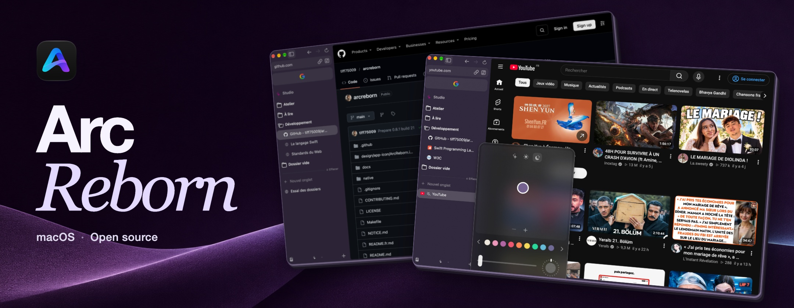
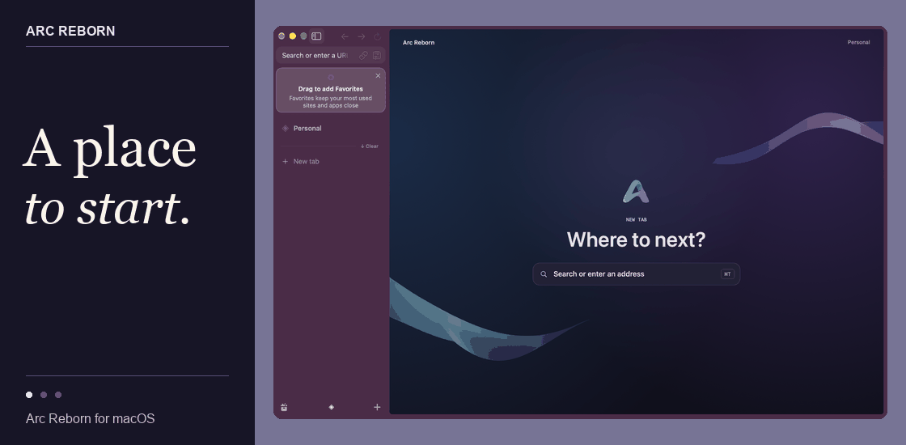
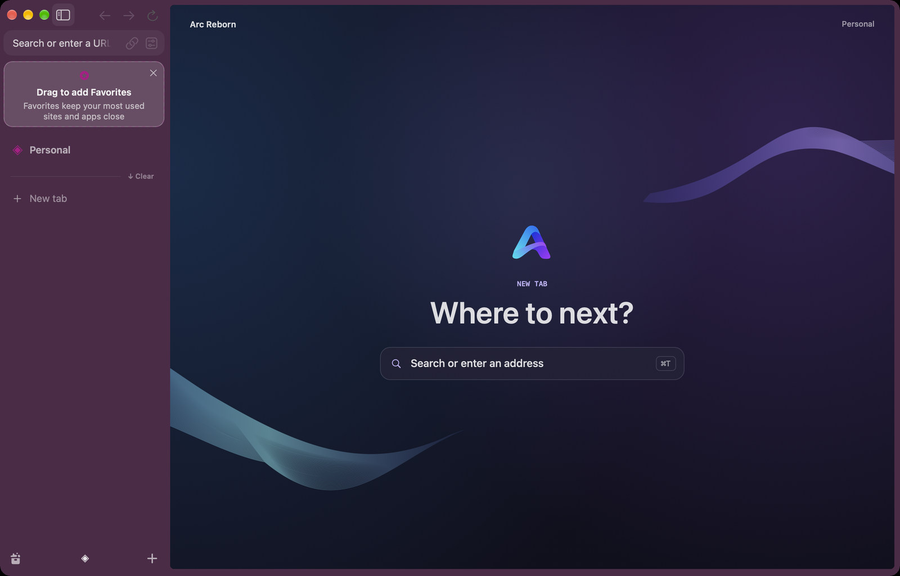
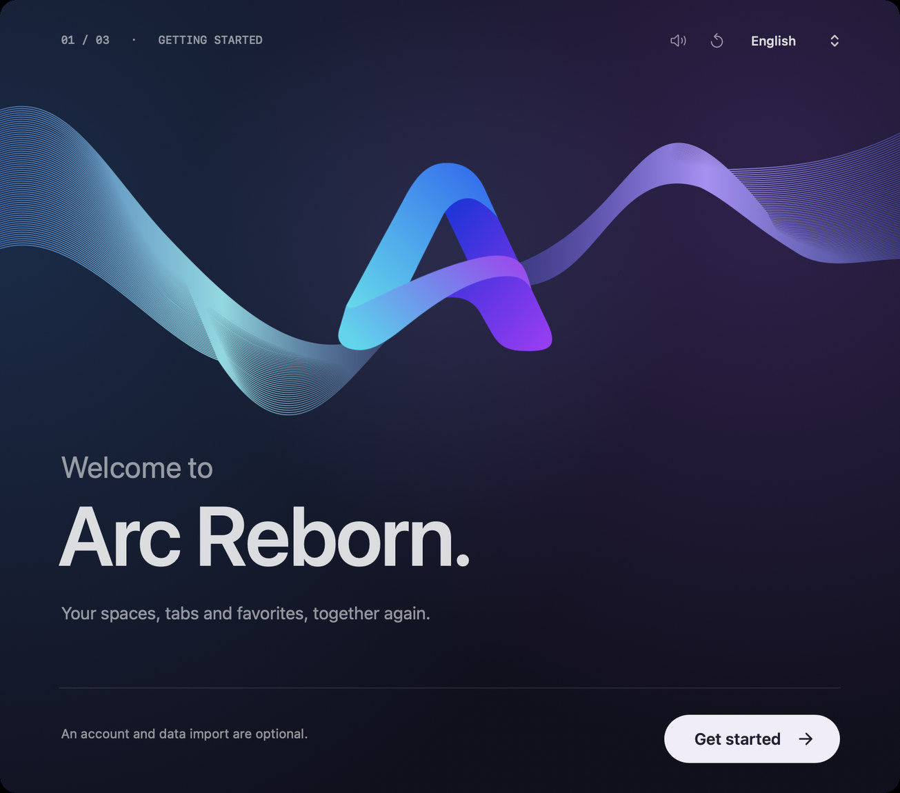
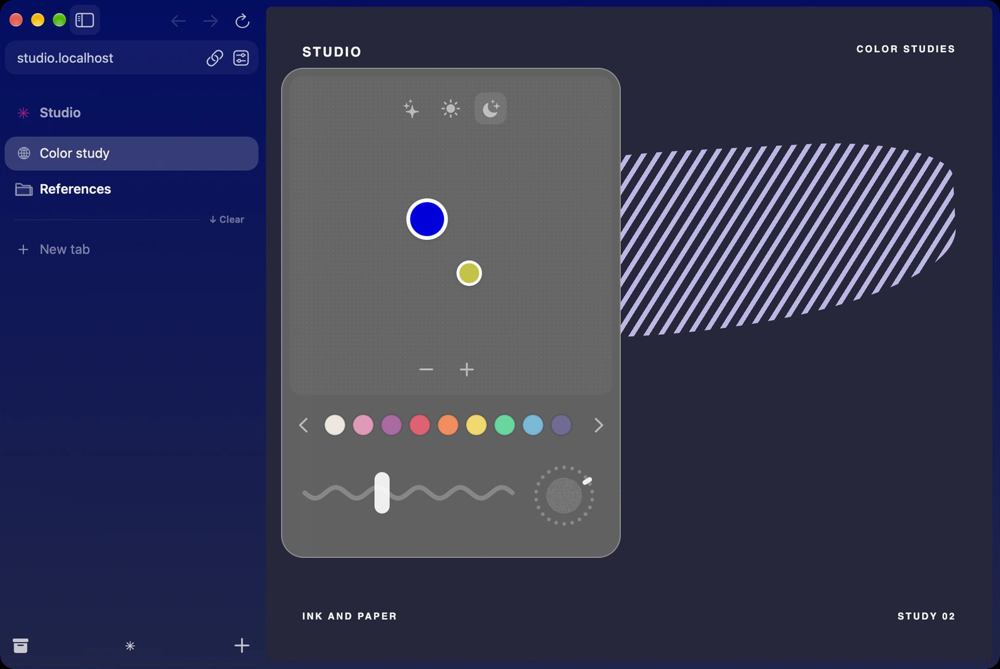
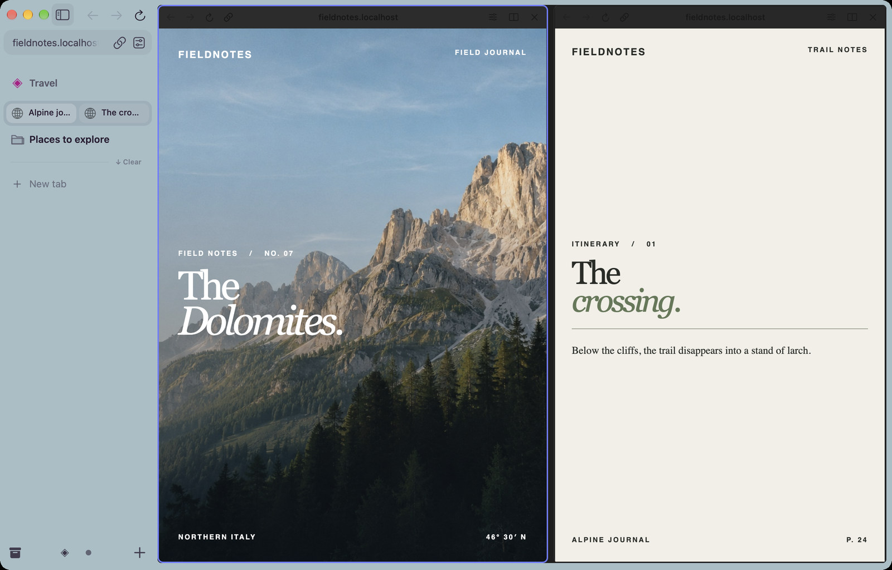
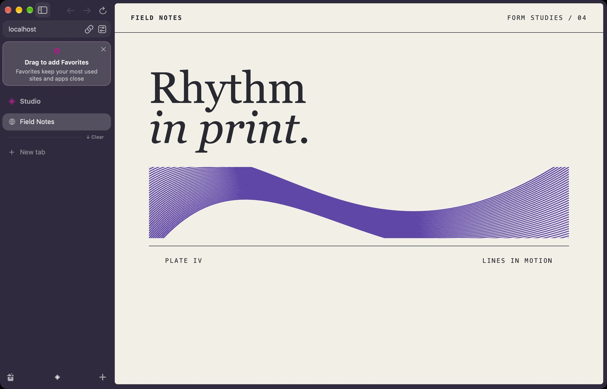
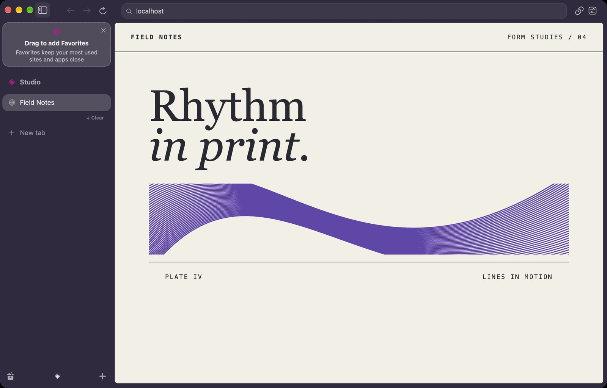
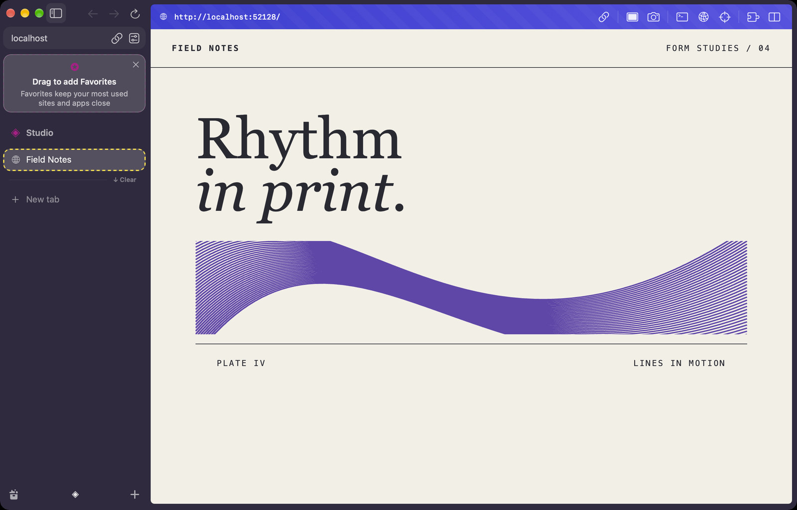
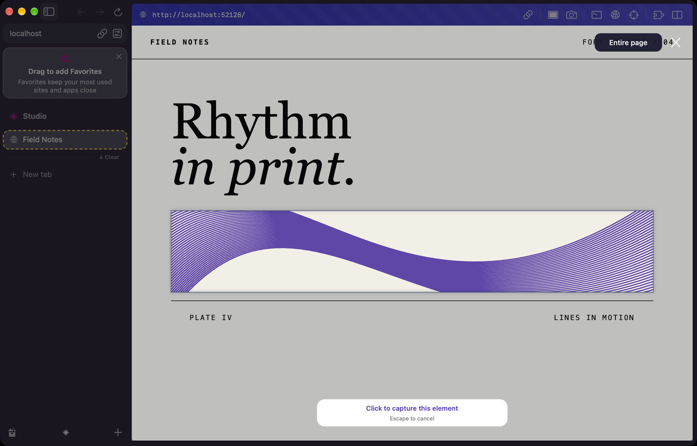

<p align="center"></p>

<p align="center">
  <a href="https://www.arc-reborn.com/download/mac"></a>
</p>
<p align="center">
  <a href="https://www.arc-reborn.com/"></a> &nbsp; <a href="https://github.com/tiff75009/arcreborn/releases"></a>
</p>

<p align="center"><strong>English</strong> · <a href="README.fr.md">Français</a></p>

# Arc Reborn

Arc Reborn is an independent, open-source browser for Mac. I’m building it for people who want to keep using Arc the way they already do. My aim is to recreate its look, motion and everyday behavior as faithfully as possible. I want you to recognize your Space by its color and know where a pinned tab will land before you let go of it.

I used Codex and Claude to reverse-engineer parts of Arc’s behavior. The implementation pairs a native **Swift and AppKit** interface with a customized **Chromium Embedded Framework (CEF)**. This is an independent project in active development, unaffiliated with Arc or The Browser Company.



## A closer look

| A fresh tab | First launch |
| :--- | :--- |
| [](docs/showcase/home.jpg) | [](docs/showcase/welcome.jpg) |
| Open the command bar to find a tab or enter an address. | Bring over supported browser data and choose whether to set up encrypted sync. |

| Color a Space | Work side by side |
| :--- | :--- |
| [](docs/showcase/theme.jpg) | [](docs/showcase/split.jpg) |
| Drag a color handle and watch the sidebar update as you move it. | Keep two live pages in view, with the sidebar still within reach. |

**In the sidebar.** Keep everyday sites in Favorites, pin tabs inside a Space, and group related tabs into folders. Assign a Space to a separate profile when work and personal sites need different sign-ins. The command bar lets you switch tabs without having to remember which folder they’re in.

**In motion.** Watch a folder icon as it opens: the front flap folds away from the back. Switching Spaces slides the sidebar into place. These details help you see what opened and where you landed. Both movements respect the Mac’s Reduce Motion setting.

## Two ways to arrange the browser

Choose **Preferences → Interface** to switch layouts. Both keep your tabs and Spaces in the sidebar.

| Compact · the default | Classic |
| :--- | :--- |
| [](docs/showcase/layout-compact.jpg) | [](docs/showcase/layout-classic.jpg) |
| The address, Back, Forward and Reload sit in the sidebar. The page starts at the top of the window. | The address bar runs across the top of the page. Your tabs stay stacked vertically on the left. |

> [!TIP]
> Press **⌘T** in either layout to open the command bar.

## Developer Mode and Capture

| Developer Mode | Capture an element |
| :--- | :--- |
| [](docs/showcase/developer.jpg) | [](docs/showcase/capture.jpg) |

Enable **Developer Mode** on a tab to bring its tools above the page. Copy the current URL, open the Chromium console or network panel, inspect an element, or take a portrait capture. The goal is the same working rhythm as Arc: inspect the page you’re building and keep your reference open beside it.

Press **⇧⌘2** to start a capture. Move over the page to highlight an element and click to capture it, or drag to select a rectangle. Choose **Capture Full Page** for the entire loaded document. Then annotate with arrows, text, shapes or freehand drawing, copy the PNG, save it, or share it through macOS.

## Languages and translators

The browser and this guide are available in **English and French**. I’d love to bring the same experience to more languages, including the small things like menu verbs, shortcut hints and the welcome screens.

> [!NOTE]
> **Want to translate Arc Reborn into your language?** [Open a translation request](https://github.com/tiff75009/arcreborn/issues/new?title=Translation%3A%20) and tell me the language or regional variant and which part you’d like to help with. Reviewing a handful of interface labels is a good place to start. For code contributions, see the [current UI strings](native/Sources/Localization.swift) and the [contribution guide](CONTRIBUTING.md).

## Install and build

The public DMG runs on **Apple silicon Macs with macOS 13 or later**. You can browse locally without an account. Official builds receive signed updates through Sparkle. Check manually in **Preferences → General**. [Latest release and checksums](https://github.com/tiff75009/arcreborn/releases/latest)

To build locally, install Xcode and CMake on an Apple silicon Mac, then run:

```sh
git clone https://github.com/tiff75009/arcreborn.git
cd arcreborn
make dev
```

The first build downloads and verifies the pinned engine and Sparkle. It launches with a separate development profile. Use `make build` to compile, `make check` for focused checks, or `make demo-onboarding` to open the standalone welcome demo. Press **⌘R** in the demo to replay it with music.

[Architecture and current limits](docs/development/architecture.md) · [Rebuild the engine and Chromium patches](docs/development/engine.md) · [Signing and releases](docs/development/releases.md) · [Report a security issue](SECURITY.md)

Arc Reborn’s original code is licensed under [MPL-2.0](LICENSE). Upstream components retain their [own licenses](NOTICE.md).
